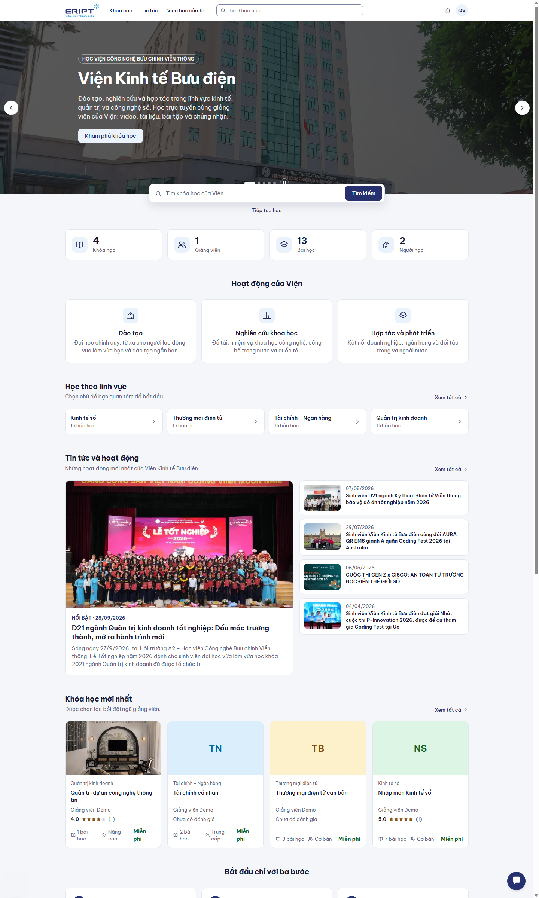
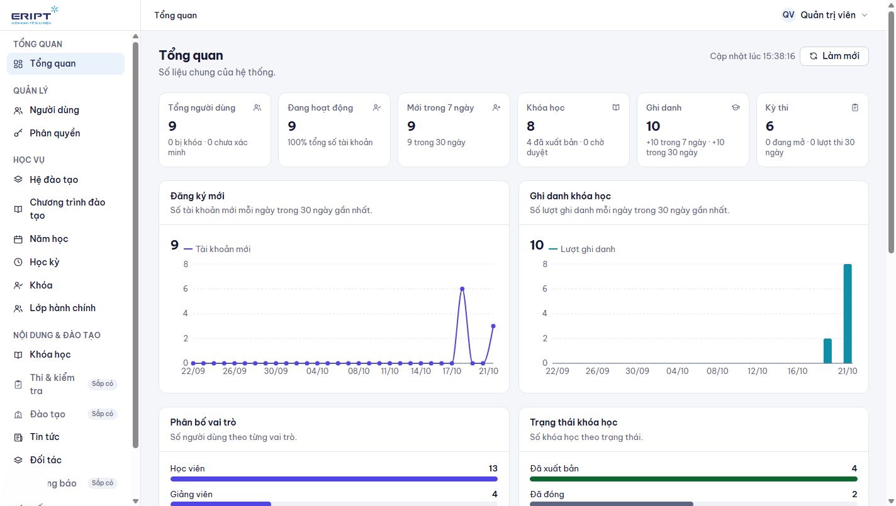
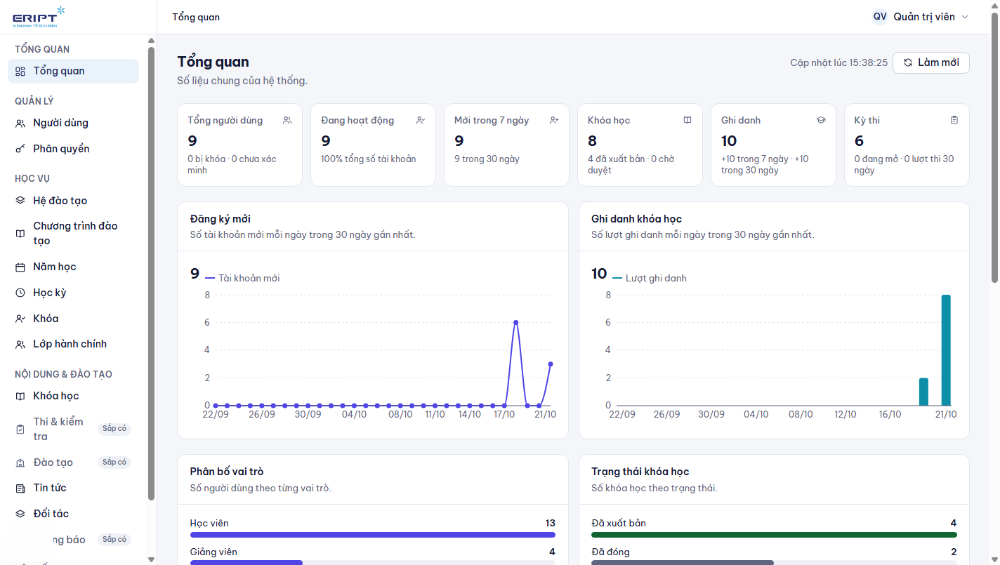
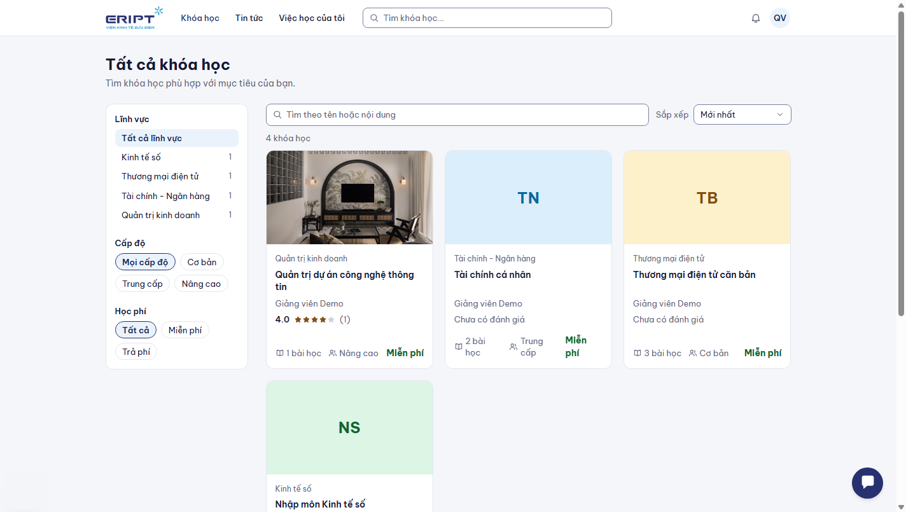
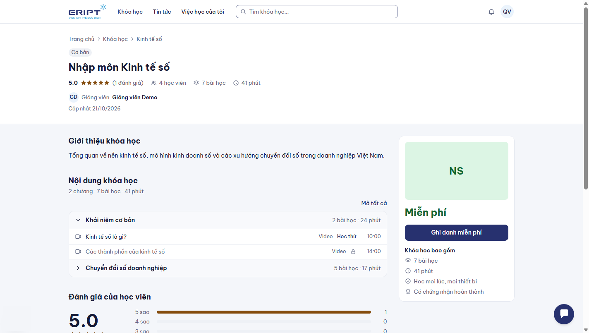

# Đăng nhập, đăng ký và tài khoản

Áp dụng cho mọi vai trò.

## 1. Trang chủ

Trang chủ công khai (không cần đăng nhập) có: slider tin nổi bật, ô tìm khóa học, số liệu của hệ thống, các lĩnh vực, tin tức, khóa học, đối tác và câu hỏi thường gặp.

- Gõ từ khóa vào ô **Tìm khóa học của Viện...** rồi bấm **Tìm kiếm**.
- Slider tự chuyển sau vài giây; rê chuột vào hoặc bấm nút tạm dừng để dừng. Dùng mũi tên hai bên, chấm tròn bên dưới hoặc phím mũi tên trái phải để chuyển slide.
- Bấm **Đăng nhập** hoặc **Đăng ký** ở góc phải trên cùng.

## 2. Đăng ký tài khoản

1. Bấm **Đăng ký**, nhập họ tên, email và mật khẩu.
2. Hệ thống gửi email xác thực. Mở email và bấm vào đường dẫn xác thực.
3. Quay lại trang đăng nhập và đăng nhập.

Sinh viên của Viện thường được **nhà trường tạo sẵn tài khoản**; trong trường hợp đó bạn chỉ cần đăng nhập (xem mục 3).

## 3. Đăng nhập

1. Mở trang **Đăng nhập**, nhập email và mật khẩu, bấm **Đăng nhập**.
2. Hệ thống đưa bạn vào đúng nơi làm việc của vai trò:

| Vai trò | Trang đầu tiên |
|---|---|
| Sinh viên | Việc học của tôi |
| Giảng viên | Studio |
| Cố vấn học tập | Lớp quản lý |
| Giáo vụ | Học vụ > Lớp hành chính |
| Quản trị viên | Tổng quan quản trị |

Bấm biểu tượng con mắt để xem mật khẩu đang gõ. Tick **Ghi nhớ đăng nhập** nếu dùng máy cá nhân.

## 4. Quên mật khẩu

1. Ở trang đăng nhập, bấm **Quên mật khẩu?**
2. Nhập email tài khoản và gửi. Hệ thống gửi đường dẫn đặt lại mật khẩu về email.
3. Mở email, bấm đường dẫn, nhập mật khẩu mới.

Nếu không thấy email, kiểm tra thư rác. Nếu vẫn không có, báo quản trị viên kiểm tra cấu hình gửi email của hệ thống.

## 5. Khám phá khóa học (không cần đăng nhập)

- **Khóa học** trên thanh menu mở danh mục. Lọc theo lĩnh vực, trình độ, đánh giá và sắp xếp.
- Bấm vào một khóa để xem giới thiệu, chương trình, giảng viên và đánh giá. Cần đăng nhập mới ghi danh được.

## 6. Các vai trò trong hệ thống

| Vai trò | Làm được gì |
|---|---|
| **Sinh viên** | Học khóa học, làm bài tập, thi, điểm danh, nhận chứng chỉ |
| **Giảng viên** | Tạo và quản lý khóa học của mình, ngân hàng câu hỏi, kỳ thi, chấm bài, báo cáo |
| **Cố vấn học tập** | Quản lý các lớp mình phụ trách: sinh viên, chương trình đào tạo, gán môn, xem báo cáo lớp |
| **Giáo vụ** | Quản lý cấu trúc học vụ: hệ đào tạo, chương trình, năm học, học kỳ, khóa, lớp hành chính |
| **Quản trị viên** | Toàn quyền: người dùng, phân quyền, duyệt khóa học, tin tức, đối tác, cài đặt |
| **Tài chính** | Chưa có màn hình riêng ở phiên bản này |

Một người có thể giữ nhiều vai trò (ví dụ cố vấn học tập vừa là sinh viên). Quản trị viên gán vai trò ở **Người dùng**.

## 7. Thuật ngữ

| Từ | Nghĩa |
|---|---|
| Khóa học | Một môn học trực tuyến gồm chương và bài học |
| Khóa (niên khóa) | Nhóm sinh viên cùng năm nhập học, ví dụ "Khóa 2024" |
| Lớp hành chính | Lớp sinh hoạt của sinh viên, có cố vấn học tập |
| Chương trình đào tạo | Danh sách môn (khóa học) theo từng kỳ của một lớp |
| Học kỳ | Kỳ học thật trong một năm học; kỳ 1, kỳ 2... của chương trình được gắn với học kỳ thật |
| Ngân hàng câu hỏi | Kho câu hỏi của một khóa học dùng để ra đề |
| Nhóm câu hỏi | Cách phân loại câu hỏi trong ngân hàng theo chương hoặc chủ đề |
| Kỳ thi độc lập / cuối khóa | Kỳ thi riêng cho danh sách thí sinh, hoặc kỳ thi gắn với một khóa học |
