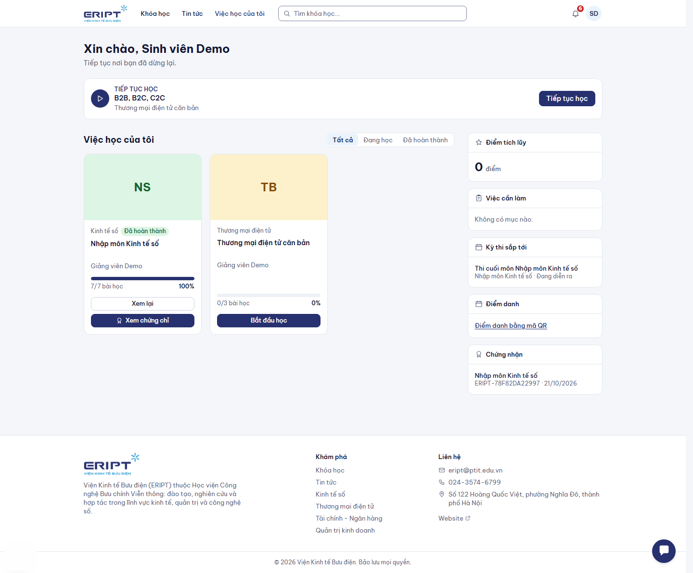
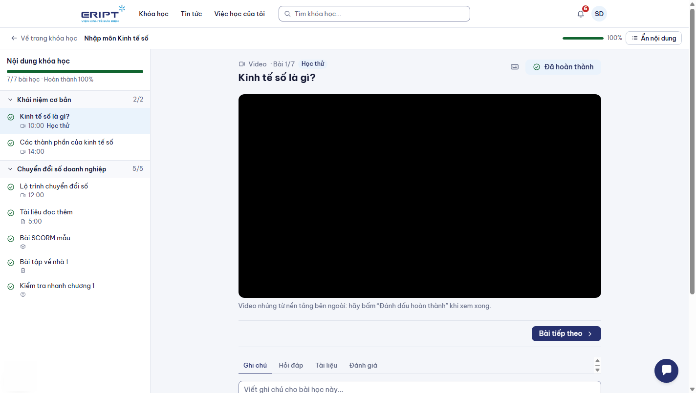
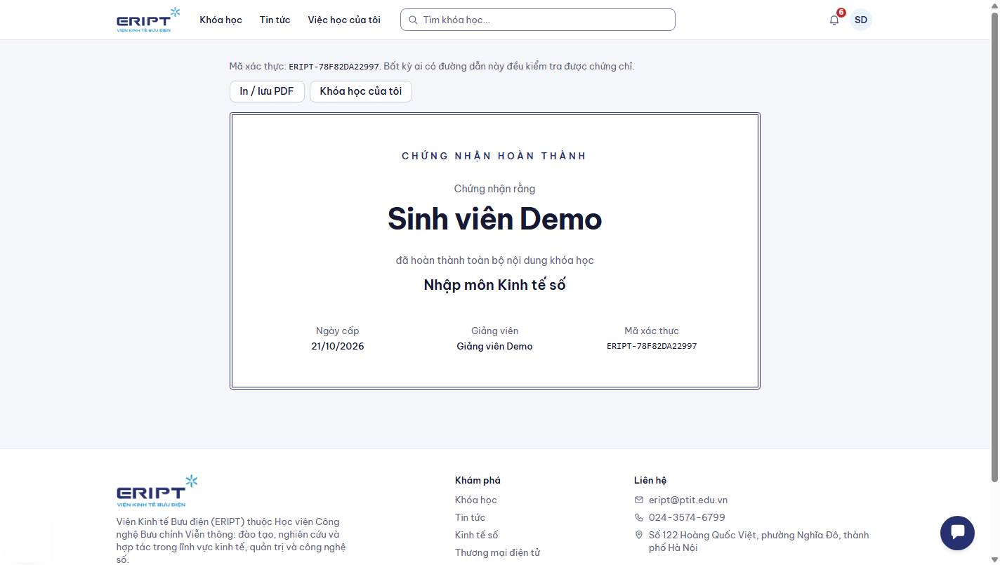
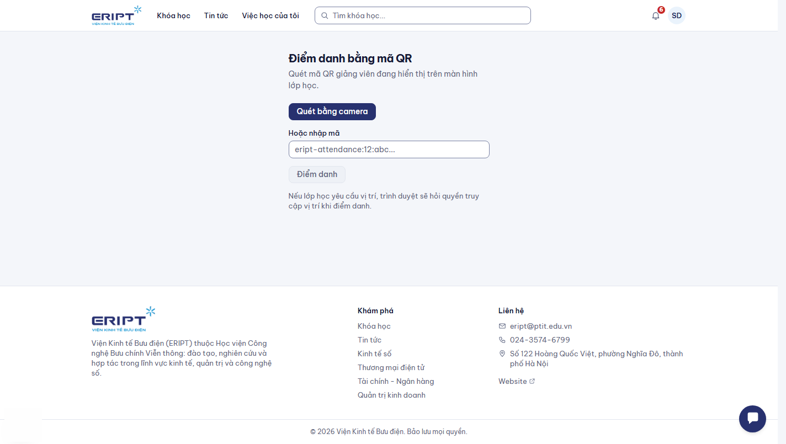

# Hướng dẫn dành cho sinh viên

Bạn dùng hệ thống để học khóa học, làm bài tập, thi, điểm danh và nhận chứng chỉ. Chưa có tài khoản hoặc quên mật khẩu: xem [00-dang-nhap-va-tai-khoan.md](00-dang-nhap-va-tai-khoan.md).

## 1. Trang "Việc học của tôi"

Sau khi đăng nhập bạn vào trang này (cũng mở được bằng **Việc học của tôi** trên thanh menu).

| Khu vực | Cho bạn biết |
|---|---|
| **Tiếp tục học** | Bài học gần nhất bạn đang dở, bấm **Tiếp tục học** để vào thẳng |
| Danh sách khóa học (**Tất cả / Đang học / Đã hoàn thành**) | Các khóa đã ghi danh kèm thanh tiến độ |
| **Điểm tích lũy** | Điểm thưởng khi học và đăng nhập đều đặn |
| **Việc cần làm** | Bài tập chưa nộp, bài quá hạn hiện chữ đỏ |
| **Kỳ thi sắp tới** | Kỳ thi bạn được tham gia, bấm vào để làm bài |
| **Điểm danh** | Ô nhập mã điểm danh (xem mục 6) |
| **Chứng chỉ** | Chứng chỉ bạn đã nhận |

Khóa học do nhà trường gán cho lớp sẽ **tự xuất hiện** ở đây, bạn không cần ghi danh.

## 2. Tìm và ghi danh khóa học

1. Bấm **Khóa học**, lọc hoặc tìm theo tên.
2. Mở khóa học để xem chương trình và giảng viên.
3. Bấm nút ghi danh. Khóa miễn phí ghi danh chỉ với một lần bấm.

Khóa có học phí chưa thanh toán trực tuyến trong phiên bản này: liên hệ giáo vụ hoặc giảng viên để được ghi danh.

## 3. Học một khóa học

Mở khóa từ **Việc học của tôi**. Màn hình học gồm danh sách chương và bài ở bên trái, nội dung bài ở giữa.

- Bấm một bài để học. Với bài đọc, tài liệu, video: học xong bấm **Đánh dấu hoàn thành**.
- **Bài tiếp theo** chuyển sang bài kế; phím tắt: `N` bài tiếp, `P` bài trước, `M` đánh dấu hoàn thành.
- Dưới bài có các thẻ **Ghi chú** (ghi theo từng bài), **Hỏi đáp** (đặt câu hỏi cho giảng viên), **Tài liệu**, **Đánh giá** (chấm sao và nhận xét khóa học).
- **Ẩn nội dung** thu gọn danh sách bài để có thêm chỗ đọc.

### Khóa học học tuần tự

Một số khóa yêu cầu hoàn thành bài trước mới mở bài sau. Bài bị khóa hiện dòng **Hãy hoàn thành bài học trước để mở bài này**. Hoàn thành bài đang mở là bài kế tiếp tự mở khóa.

### Khóa hoặc chương có giờ mở

Giảng viên có thể đặt giờ mở và đóng cho cả khóa hoặc từng chương. Bài chưa tới giờ hiện **Khóa học (hoặc Chương này) sẽ mở lúc ...**; hết giờ đóng cũng không vào được nữa.

### Các loại bài học

| Loại | Cách học |
|---|---|
| Bài đọc, tài liệu, video | Đọc hoặc xem rồi **Đánh dấu hoàn thành** |
| Bài tập | Đọc yêu cầu, đính kèm tệp (đúng định dạng và dung lượng cho phép), bấm nộp. Nộp lại trước hạn sẽ thay bài cũ. Điểm và nhận xét của giảng viên hiện ngay dưới bài |
| Bài kiểm tra nhanh | Làm trắc nghiệm ngay trong bài, có kết quả và đáp án sau khi nộp. Đạt điểm yêu cầu mới tính hoàn thành |
| SCORM | Học tương tác trong khung bài; tiến độ tự ghi |
| Lớp trực tuyến | Bấm đường dẫn vào lớp đúng giờ |

## 4. Làm bài thi

1. Từ **Việc học của tôi**, mục **Kỳ thi sắp tới**, bấm vào kỳ thi đang diễn ra.
2. **Lưu ý: mở trang kỳ thi là bắt đầu làm bài và đồng hồ chạy ngay.** Chỉ mở khi đã sẵn sàng.
3. Mỗi lần hiện một câu. Dùng **Câu trước / Câu sau** hoặc bấm số câu ở thanh bên để nhảy. Bấm **Đánh dấu xem lại** với câu muốn kiểm tra lại.
4. Cách trả lời theo loại câu:

| Loại câu | Cách làm |
|---|---|
| Một đáp án, đúng/sai | Chọn một đáp án |
| Nhiều đáp án | Tick tất cả đáp án đúng |
| Điền khuyết | Gõ vào ô trống hoặc chọn trong danh sách ngay trong câu |
| Số học | Gõ số (dùng dấu chấm hoặc phẩy cho số thập phân) |
| Trả lời ngắn | Gõ đáp án |
| Sắp xếp | Dùng nút **Lên / Xuống** để xếp đúng thứ tự |
| Ghép đôi, phân loại | Chọn hoặc kéo mục vào đúng vị trí |
| Tự luận | Gõ bài làm; giảng viên chấm sau |

5. Xong bấm **Nộp bài** (xác nhận nếu hệ thống hỏi). Màn hình hiện điểm. Câu tự luận chờ giảng viên chấm nên điểm có thể cập nhật sau.

Kỳ thi chỉ cho làm tối đa số lần giảng viên đặt (thường 1 lần).

## 5. Chứng chỉ

Khóa học có cấp chứng chỉ sẽ hiện nút khi bạn **hoàn thành 100% bài học**.

1. Vào **Việc học của tôi**, thẻ khóa học đã hoàn thành có nút **Nhận chứng chỉ**.
2. Bấm nút, hệ thống mở trang chứng chỉ có tên bạn, tên khóa học, ngày cấp và **mã xác thực**.
3. Bấm **In / lưu PDF** để lưu hoặc in. Lần sau nút đổi thành **Xem chứng chỉ**.

Người khác kiểm tra chứng chỉ của bạn bằng đường dẫn `/certificates/<mã xác thực>`, không cần đăng nhập.

## 6. Điểm danh bằng mã QR

Giảng viên hiển thị mã QR hoặc mã chữ trong buổi học.

1. Mở trang **Điểm danh** (`/check-in`) hoặc ô Điểm danh ở **Việc học của tôi**.
2. Cho phép trình duyệt dùng **camera** để quét mã QR; hoặc gõ **mã** hiển thị dưới mã QR vào ô **Hoặc nhập mã**.
3. Nếu buổi học yêu cầu vị trí, cho phép trình duyệt dùng **vị trí** và ở trong khu vực lớp học. Quá xa sẽ bị từ chối.

Trình duyệt không hỗ trợ quét thì dùng cách nhập mã. Mã QR có thể đổi sau mỗi vài giây, hãy quét mã đang hiện trên màn hình.

## 7. Thông báo

Biểu tượng chuông ở góc phải trên cùng hiện thông báo mới (bài được chấm, kỳ thi, buổi điểm danh...).

## 8. Gặp sự cố

| Tình huống | Cách xử lý |
|---|---|
| Không thấy khóa học của lớp | Kiểm tra bạn đã được cố vấn thêm vào lớp và lớp đã được gán khóa; báo cố vấn học tập |
| Bài học bị khóa | Hoàn thành bài trước (khóa tuần tự) hoặc chờ tới giờ mở |
| Không nộp được bài tập | Kiểm tra định dạng và dung lượng tệp theo yêu cầu bài |
| Chưa thấy nút Nhận chứng chỉ | Cần hoàn thành tất cả bài học và khóa học phải có cấp chứng chỉ |
| Quét QR không được | Nhập mã bằng tay; kiểm tra quyền camera của trình duyệt |
| Lỡ mở kỳ thi | Đồng hồ đã chạy; tiếp tục làm bài, hoặc báo giảng viên nếu có sự cố kỹ thuật |
