# Hướng dẫn dành cho giảng viên

Giảng viên làm việc trong **Studio**. Mọi thứ bạn tạo (khóa học, ngân hàng câu hỏi, kỳ thi) thuộc về bạn; giảng viên khác không thấy. Quản trị viên xem được tất cả.

Đăng nhập: xem [00-dang-nhap-va-tai-khoan.md](00-dang-nhap-va-tai-khoan.md).

## 1. Làm quen với Studio

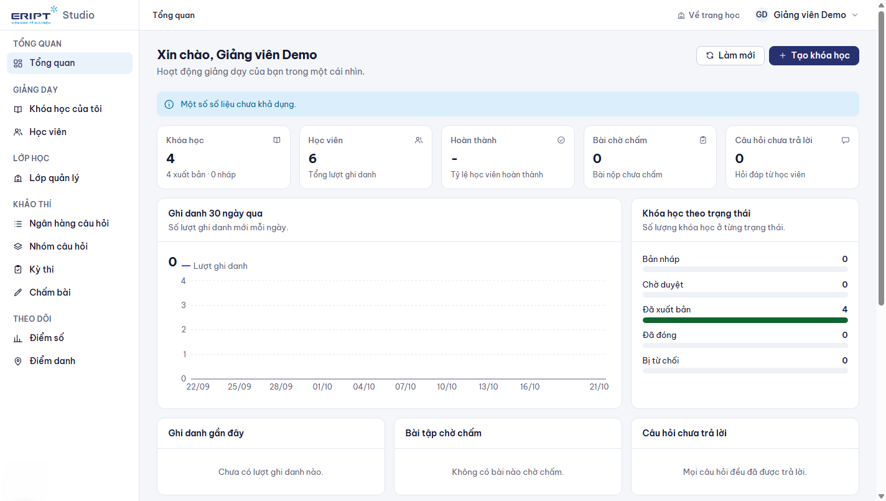

Thanh menu bên trái gồm các nhóm:

| Nhóm | Mục | Dùng để |
|---|---|---|
| Giảng dạy | **Khóa học của tôi**, **Học viên** | Tạo và quản lý khóa học; xem toàn bộ học viên các khóa của bạn |
| Lớp học | **Lớp quản lý** | Các lớp có sinh viên học khóa của bạn |
| Khảo thí | **Ngân hàng câu hỏi**, **Nhóm câu hỏi**, **Kỳ thi**, **Chấm bài** | Ra đề, tổ chức thi, chấm tự luận và bài tập |
| Theo dõi | **Điểm số**, **Điểm danh** | Bảng điểm thành phần và điểm danh buổi học |

Trang **Tổng quan** tóm tắt số khóa học, học viên, tỉ lệ hoàn thành, bài chờ chấm và câu hỏi chưa trả lời.

## 2. Tạo khóa học

1. **Khóa học của tôi > Tạo khóa học**.

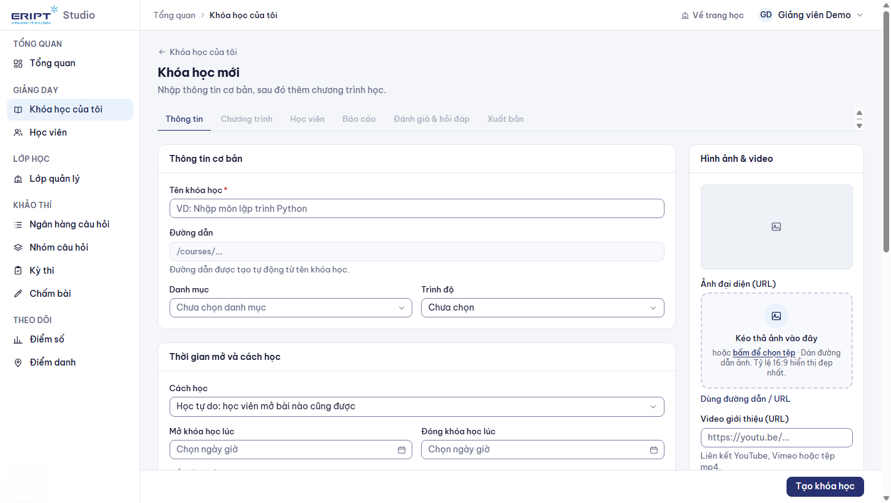

2. Điền tab **Thông tin**:

| Mục | Ý nghĩa |
|---|---|
| Tên khóa học | Bắt buộc. Đường dẫn tự sinh từ tên |
| Danh mục, Trình độ | Giúp học viên tìm khóa; danh mục bắt buộc khi xuất bản |
| **Cách học** | **Học tự do**: mở bài nào cũng được. **Học tuần tự**: hoàn thành bài trước mới mở bài sau |
| **Mở khóa học lúc / Đóng khóa học lúc** | Để trống nếu mở liên tục. Dùng bộ chọn ngày giờ để đặt |
| **Cấp chứng chỉ khi học viên hoàn thành tất cả bài học** | Tick để học viên nhận chứng chỉ khi xong 100% |
| Mô tả, ảnh đại diện, video giới thiệu, học phí | Hiển thị trên trang khóa học |

3. Bấm **Tạo khóa học**. Hệ thống chuyển sang trang biên tập với các tab: **Thông tin**, **Chương trình**, **Học viên**, **Báo cáo**, **Đánh giá và hỏi đáp**, **Xuất bản**.

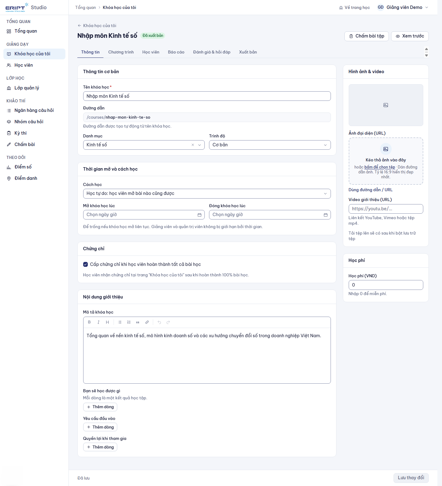

Dấu chấm vàng cạnh tab Thông tin nghĩa là có thay đổi chưa lưu; bấm **Lưu thay đổi** ở thanh dưới cùng.

## 3. Xây chương trình học

Tab **Chương trình**.

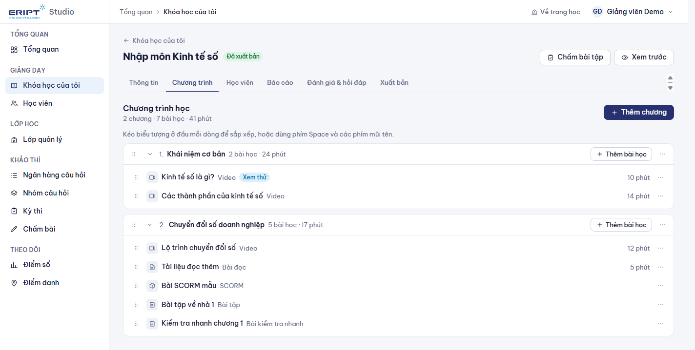

1. **Thêm chương**: gõ tên chương rồi Enter.
2. **Thêm bài học** trong chương: điền **Tên bài học**, chọn **Loại bài học** và nội dung.

| Loại bài | Nội dung cần nhập |
|---|---|
| Video | Đường dẫn video (YouTube...) hoặc tệp |
| Bài đọc | Soạn nội dung ngay trong trình soạn thảo |
| Tài liệu | Tệp đính kèm |
| Bài tập | Yêu cầu, dung lượng và định dạng tệp cho phép, giờ mở và hạn nộp |
| Bài kiểm tra nhanh | Chọn câu hỏi từ ngân hàng, điểm đạt, thời gian |
| SCORM | Tải gói `.zip` SCORM lên |
| Lớp trực tuyến, trực tiếp | Đường dẫn buổi học và thời gian |

3. **Sắp xếp**: kéo biểu tượng ở đầu dòng; hoặc dùng bàn phím: Space để nhấc, mũi tên để di chuyển, Space để thả.
4. **Thời gian mở của chương**: ở menu thao tác của chương chọn **Thời gian mở**, đặt giờ mở và đóng. Học viên chỉ vào được bài của chương trong khoảng đó.
5. Đổi tên, xóa chương hoặc bài ở menu thao tác (chương còn bài thì phải chuyển hoặc xóa bài trước).

Nút **Học thử** xem khóa học như học viên.

## 4. Quản lý học viên của khóa

Tab **Học viên**.

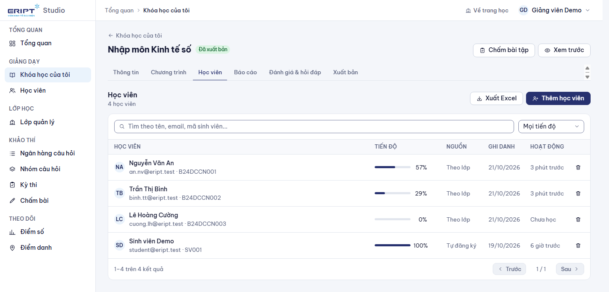

- **Thêm học viên**: nhập mỗi dòng một email hoặc mã sinh viên (hoặc tải tệp Excel có danh sách ở cột đầu), bấm **Thêm vào khóa học**. Hệ thống báo số đã thêm, đã có sẵn và không tìm thấy.
- Danh sách có tìm kiếm, lọc theo tiến độ, tiến độ từng người, nguồn ghi danh (thủ công, theo lớp, tự đăng ký), nút xóa khỏi khóa và **xuất danh sách**.
- Học viên của lớp hành chính được cố vấn gán sẽ tự có mặt ở đây với nguồn **Theo lớp**.

## 5. Ngân hàng câu hỏi

**Khảo thí > Ngân hàng câu hỏi**, chọn khóa học rồi **Tạo ngân hàng**. Mỗi khóa có thể có nhiều ngân hàng.

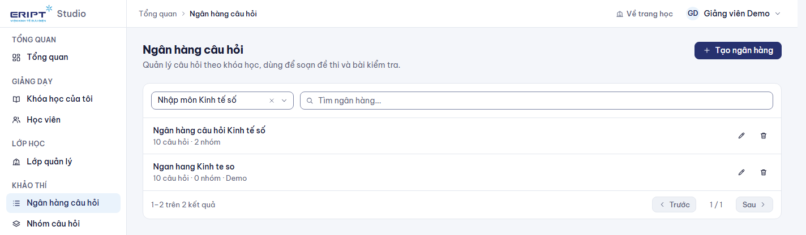

### 5.1 Thêm câu hỏi

Mở ngân hàng, bấm **Thêm câu hỏi**. Các dạng câu hỏi:

| Dạng | Ghi chú |
|---|---|
| Một đáp án, nhiều đáp án, đúng/sai | Đánh dấu đáp án đúng |
| Trả lời ngắn, số học | Nhập các đáp án chấp nhận; số học có sai số cho phép |
| Sắp xếp | Nhập các mục theo đúng thứ tự |
| Ghép đôi, phân loại | Mỗi mục có vế ghép hoặc nhóm |
| Điền khuyết | Dùng `{{1}}`, `{{2}}` trong nội dung cho từng ô trống |
| Tự luận | Giảng viên chấm tay |
| Đoạn văn | Một đoạn dùng chung có các câu hỏi con |

Mỗi câu có **độ khó** (Rất dễ đến Rất khó), **điểm**, **nhóm** và **giải thích** hiện cho học viên sau khi thi.

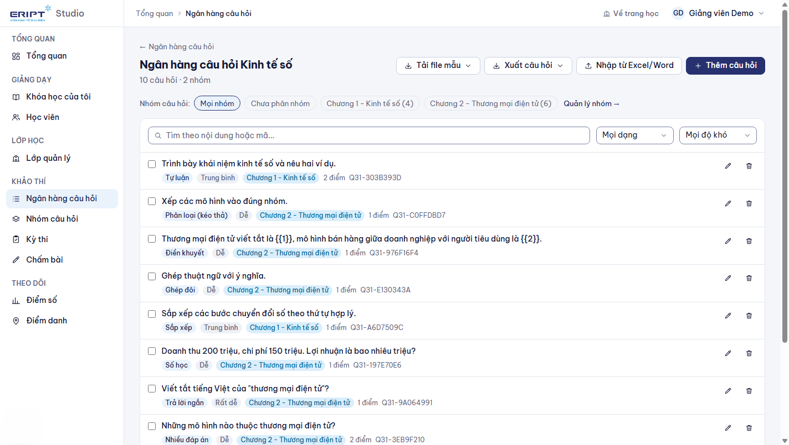

### 5.2 Nhập và xuất bằng Excel hoặc Word

1. Bấm **Tải file mẫu** rồi chọn **Mẫu Excel** hoặc **Mẫu Word** để lấy file mẫu có sẵn 10 câu ví dụ đủ các dạng.

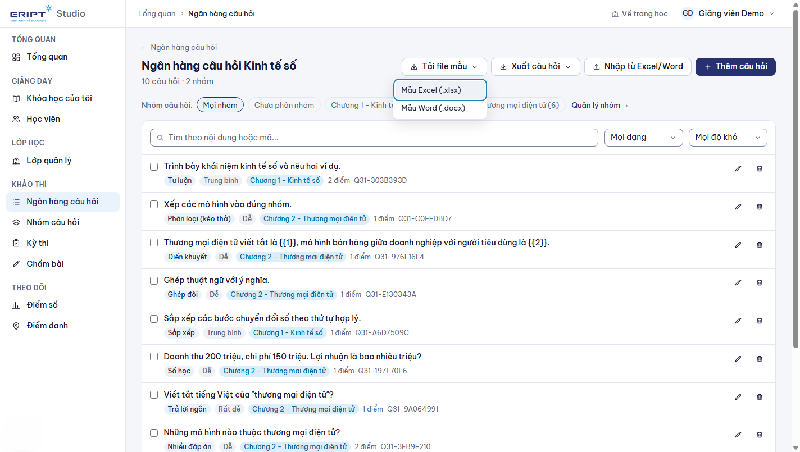

2. Điền câu hỏi của bạn vào file mẫu (xem 5.3), lưu lại.
3. Bấm **Nhập từ Excel/Word**, chọn file, bấm **Kiểm tra** để xem trước số câu hợp lệ và lỗi từng dòng, rồi **Nhập vào ngân hàng**.
4. **Xuất câu hỏi** xuất cả ngân hàng ra Excel hoặc Word (để sao lưu hoặc chuyển ngân hàng khác).

File mẫu cũng nằm sẵn trong [mau-nhap-cau-hoi](../mau-nhap-cau-hoi/): `mau-nhap-cau-hoi.xlsx`, `mau-nhap-cau-hoi.docx` và `mau-de-thi-dang-bang.docx`.

### 5.3 Cách điền file

**Excel**: mỗi dòng một câu. Các cột: Loại, Nội dung, Độ khó (1-5), Điểm, đáp án A đến F, Đáp án đúng, Giải thích, **Nhóm câu hỏi**. Đáp án đúng ghi chữ cái (`B`, hoặc `A,C` cho nhiều đáp án). Sheet **Hướng dẫn** trong file mẫu giải thích từng cột.

**Word kiểu danh sách**: mỗi câu bắt đầu bằng `Câu 1:`; đáp án `A.`, `B.`, `C.` (dùng được cả danh sách đánh số tự động của Word); dòng `Đáp án: B`; tùy chọn các dòng `Loại:`, `Nhóm:`, `Độ khó:`, `Điểm:`, `Giải thích:`.

**Word kiểu bảng**: một bảng, hàng đầu là tiêu đề `Câu hỏi | A | B | C | D | Đáp án` (thêm tùy ý cột `Loại`, `Nhóm`, `Độ khó`, `Điểm`, `Giải thích`), mỗi hàng sau là một câu. Đáp án có thể ghi chữ cái hoặc chép lại nội dung đáp án.

Lưu ý:
- Câu không có đáp án và không có phương án tự thành **tự luận**.
- **Hình ảnh** trong đề được thay bằng dấu `[hình ảnh]`; hãy chèn lại ảnh sau khi nhập. **Công thức** được đọc thành chữ thường.
- Tên nhóm trong cột **Nhóm câu hỏi** hoặc dòng `Nhóm:` sẽ **tự tạo nhóm** nếu chưa có.

### 5.4 Nhóm câu hỏi

Dùng để phân loại theo chương hoặc chủ đề. Quản lý ở màn riêng **Khảo thí > Nhóm câu hỏi**.

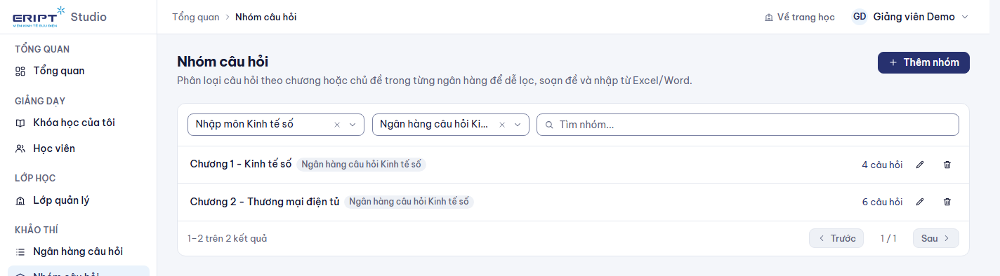

- Chọn khóa học, có thể lọc theo ngân hàng và tìm theo tên.
- **Thêm nhóm**, sửa tên và mô tả (biểu tượng bút), xóa (biểu tượng thùng rác). Trùng tên trong cùng ngân hàng sẽ bị từ chối.
- Xóa nhóm **không xóa câu hỏi**: câu hỏi chuyển về "Chưa phân nhóm".
- Bấm số câu hỏi của nhóm để mở ngân hàng đã lọc đúng nhóm đó.
- Trong ngân hàng, tick nhiều câu rồi dùng thanh thao tác để **chuyển nhóm** hoặc **xóa đã chọn**.

## 6. Kỳ thi

**Khảo thí > Kỳ thi > Tạo kỳ thi**.

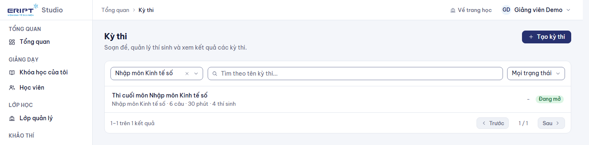

| Loại | Dùng khi | Thí sinh |
|---|---|---|
| **Kỳ thi độc lập** | Thi riêng, không gắn khóa học | Bạn ghi danh thí sinh ở tab **Thí sinh** |
| **Thi cuối khóa** | Thi của một khóa học | Tự là học viên của khóa |

Điền tên, thời gian làm bài. Sau khi tạo, kỳ thi có các tab **Cài đặt**, **Đề thi**, **Thí sinh**, **Kết quả**.

### 6.1 Cài đặt

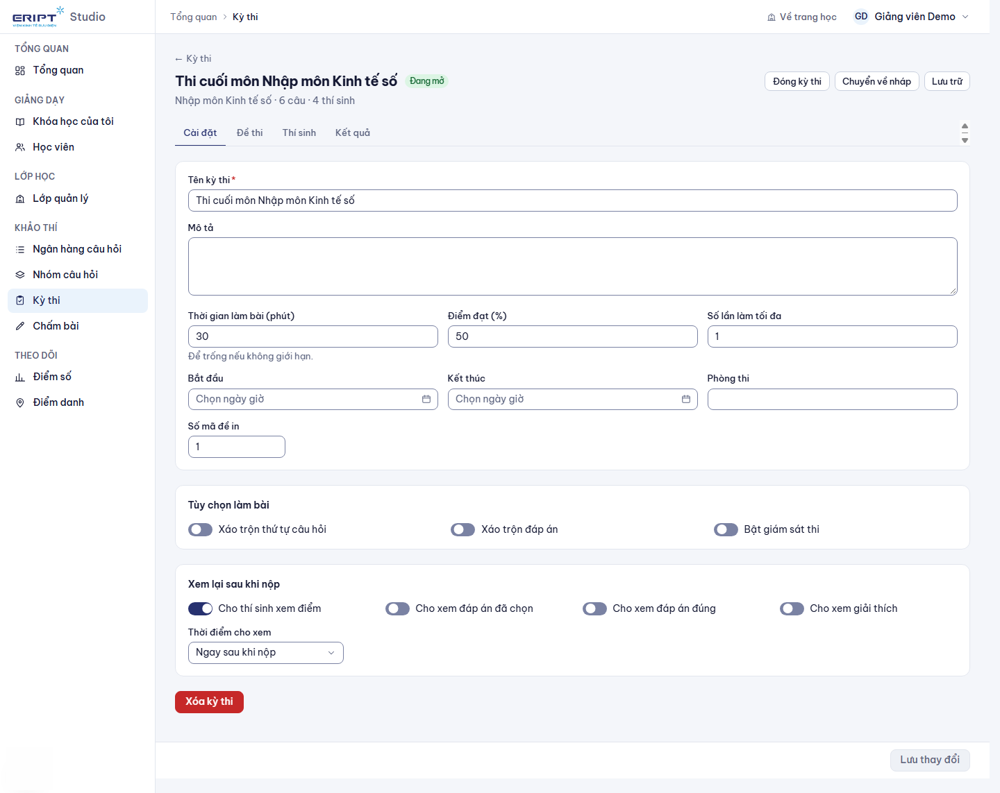

Thời gian làm bài, **điểm đạt (%)**, số lần làm tối đa, **bắt đầu** và **kết thúc** (để trống nếu không giới hạn), phòng thi, số mã đề. Mục **Tùy chọn làm bài**: xáo trộn thứ tự câu, xáo trộn đáp án, bật giám sát thi. Mục **Xem lại sau khi nộp**: cho thí sinh xem điểm, đáp án đã chọn, đáp án đúng, giải thích và thời điểm cho xem.

### 6.2 Soạn đề

Tab **Đề thi** có hai phần:

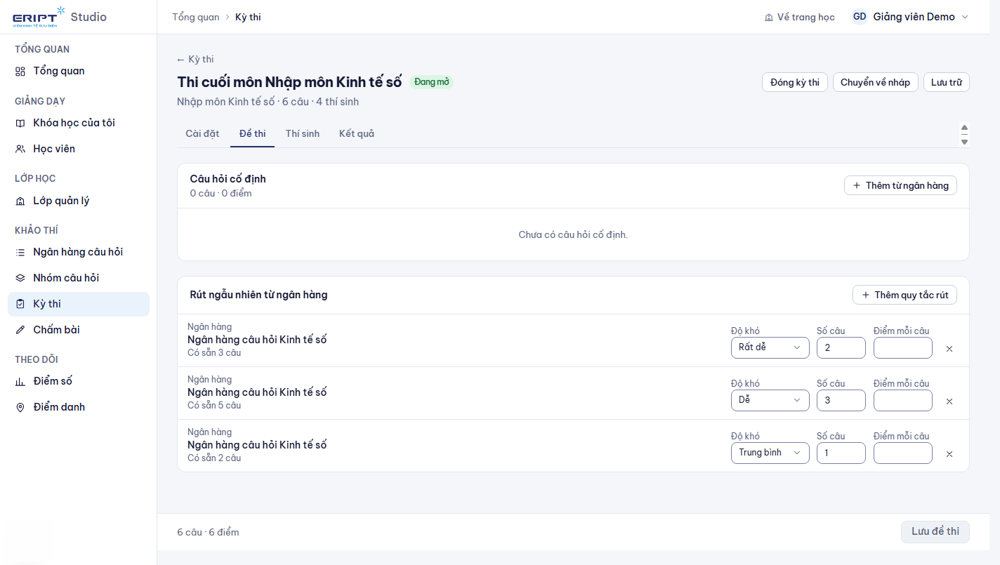

- **Câu hỏi cố định**: chọn câu hỏi cụ thể từ ngân hàng.
- **Rút ngẫu nhiên từ ngân hàng**: bấm **Thêm quy tắc rút**, chọn ngân hàng, rồi chọn một trong hai cách:
  - **Theo số câu**: chọn độ khó và số câu.
  - **Theo tỉ lệ % độ khó**: nhập tổng số câu và tỉ lệ cho từng mức độ khó (tổng phải đúng 100%). Hệ thống chia số câu và cho biết số câu có sẵn; mức nào ngân hàng không đủ sẽ báo đỏ và chặn thêm.

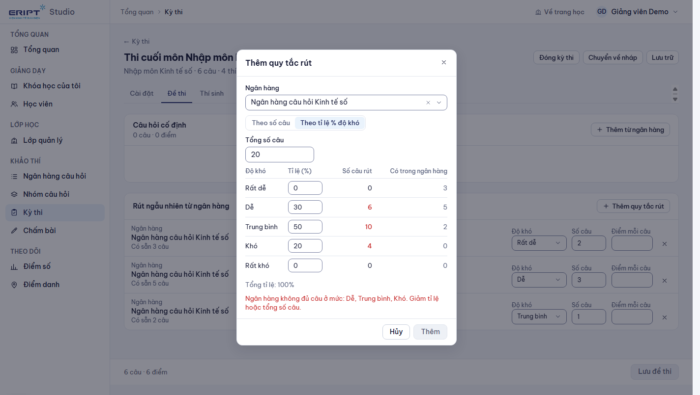

Mỗi thí sinh nhận bộ câu được rút ngẫu nhiên theo quy tắc. Bấm **Lưu đề thi** sau khi chỉnh.

### 6.3 Mở kỳ thi và xem kết quả

- Các nút ở góc trên: **Mở kỳ thi**, **Lên lịch**, **Đóng kỳ thi**, **Chuyển về nháp**, **Lưu trữ**. Kỳ thi chỉ cho thí sinh vào khi ở trạng thái **Đang mở**.
- Kỳ thi đã có bài làm không xóa được, chỉ lưu trữ.
- Tab **Kết quả** liệt kê từng thí sinh, điểm và trạng thái đạt.
- Câu **tự luận** chờ chấm ở **Khảo thí > Chấm bài**: mở bài làm, cho điểm và nhận xét từng câu.

## 7. Chấm bài tập và bài tự luận

**Khảo thí > Chấm bài** liệt kê các bài làm chờ chấm. Mở một bài để xem, cho điểm, nhập nhận xét và lưu. Bài tập nộp tệp: ở trang biên tập khóa học bấm **Chấm bài tập**, tải tệp học viên nộp về xem, cho điểm và nhận xét.

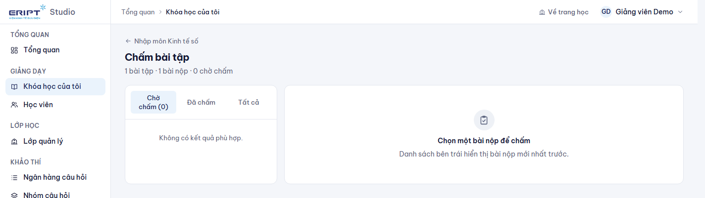

## 8. Báo cáo của khóa

Tab **Báo cáo** trong khóa học.

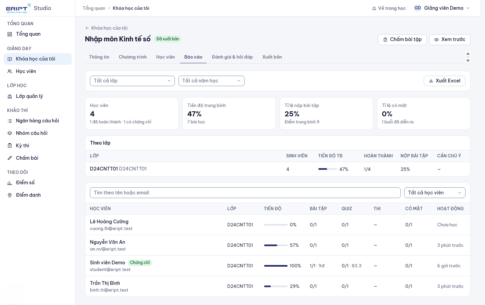

- Bốn thẻ đầu: số học viên, tiến độ trung bình, tỉ lệ nộp bài tập, tỉ lệ có mặt.
- Bộ lọc **Tất cả lớp** và **Tất cả năm học**: chọn nhiều giá trị (tick nhiều ô, có ô tìm kiếm) để xem riêng từng lớp hoặc năm. **Xóa bộ lọc** để quay lại tất cả.
- Bảng **Theo lớp** tóm tắt từng lớp; bấm một lớp để lọc riêng lớp đó.
- Bảng học viên: tiến độ, bài tập đã nộp và điểm, quiz, điểm thi cao nhất, số buổi có mặt, hoạt động gần nhất. Nhãn **Cần chú ý** chỉ học viên chưa hoàn thành mà không hoạt động 14 ngày (hoặc vào lớp quá 7 ngày chưa học). Nhãn **Chứng chỉ** là đã nhận chứng chỉ.
- Bấm một học viên để xem **chi tiết**: từng bài học hoàn thành, bài tập, quiz, điểm danh.
- **Xuất Excel** tải đúng phần đang lọc.

Trang **Học viên** ở menu tổng hợp học viên của mọi khóa bạn dạy.

## 9. Điểm số và điểm danh

### Điểm số

**Theo dõi > Điểm số**: chọn khóa học, thiết lập **thành phần điểm** (tên, trọng số, điểm tối đa; tổng trọng số phải đúng 100%, có mẫu nhanh), rồi nhập điểm từng học viên.

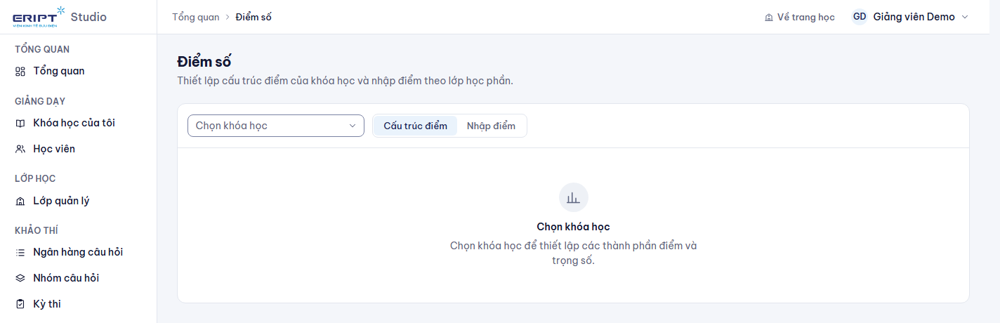

### Điểm danh

**Theo dõi > Điểm danh**: tạo buổi học (thời gian, địa điểm). Chọn cách điểm danh:
- **Thủ công**: bạn đổi trạng thái từng sinh viên (có mặt, muộn, có phép, vắng).
- **Mã QR đổi liên tục** hoặc **mã QR cố định** đến hết buổi: chiếu mã lên màn hình, sinh viên quét hoặc nhập mã.
- Có thể yêu cầu **vị trí GPS** trong bán kính nhất định quanh lớp học.

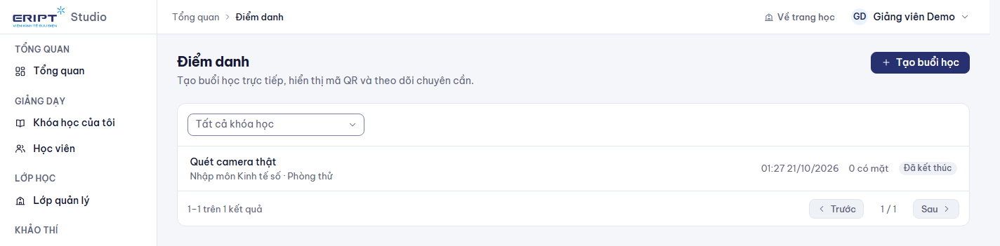

## 10. Xuất bản khóa học

Tab **Xuất bản** có danh sách kiểm tra: tên, mô tả, ít nhất 1 bài học, danh mục (bắt buộc), ảnh đại diện và học phí (nên có).

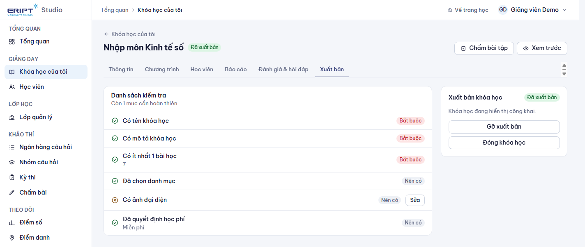

1. Đủ mục bắt buộc thì bấm **Gửi duyệt**. Trạng thái chuyển **Chờ duyệt**.
2. Quản trị viên duyệt và xuất bản. Bị từ chối: đọc lý do, chỉnh sửa rồi gửi duyệt lại.
3. Khóa đã xuất bản có thể **Gỡ xuất bản**, **Đóng khóa học** (học viên mới không ghi danh được) hoặc **Mở lại thành bản nháp**.

## 11. Lớp quản lý

Mục **Lớp quản lý** liệt kê các lớp có sinh viên học khóa của bạn. Bạn xem được danh sách và báo cáo lớp; việc quản lý sinh viên và chương trình đào tạo do cố vấn học tập làm (xem [03-co-van-hoc-tap.md](03-co-van-hoc-tap.md)).

## 12. Mẹo và lỗi thường gặp

| Tình huống | Cách xử lý |
|---|---|
| Không bấm được Gửi duyệt | Hoàn thiện mục bắt buộc trong danh sách kiểm tra (thường thiếu danh mục hoặc bài học) |
| Nhập Word báo "thiếu cột Đáp án đúng" | Dòng đó có phương án nhưng chưa có `Đáp án:`; thêm dòng đáp án hoặc dùng loại tự luận |
| Rút theo % báo ngân hàng không đủ câu | Giảm tỉ lệ ở mức độ khó thiếu hoặc giảm tổng số câu; kiểm tra số câu có sẵn từng mức |
| Học viên không thấy kỳ thi | Kỳ thi phải **Đang mở**, trong khoảng bắt đầu và kết thúc; kỳ thi độc lập cần ghi danh thí sinh |
| Không xóa được kỳ thi | Đã có bài làm; dùng **Lưu trữ** |
| Học viên không mở được bài | Khóa tuần tự: cần xong bài trước; hoặc chương chưa tới giờ mở |
