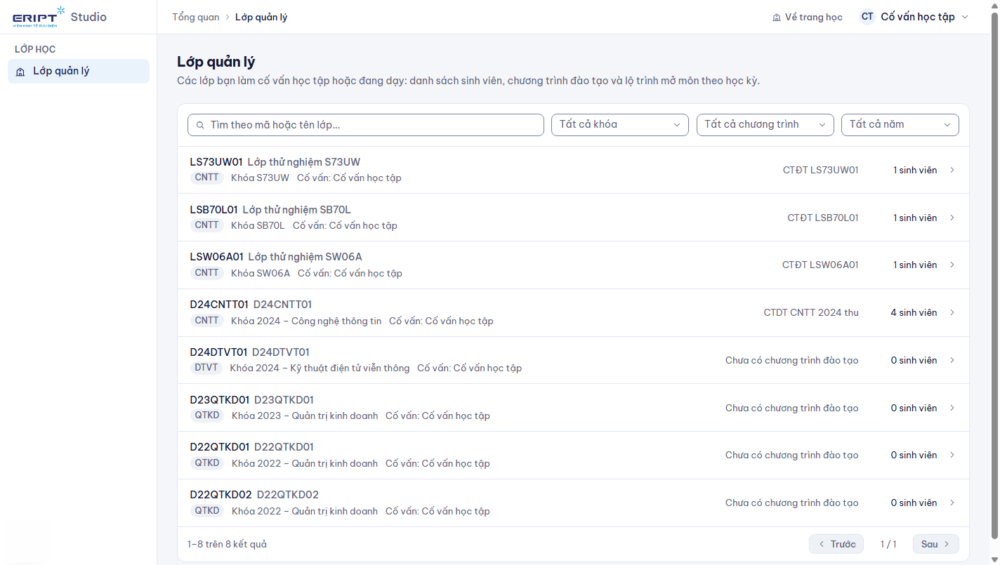
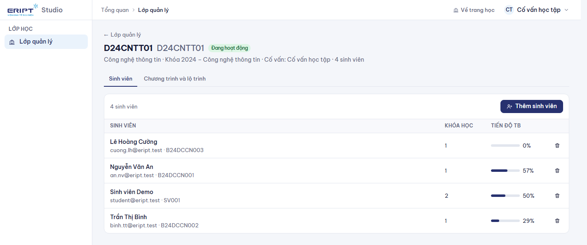
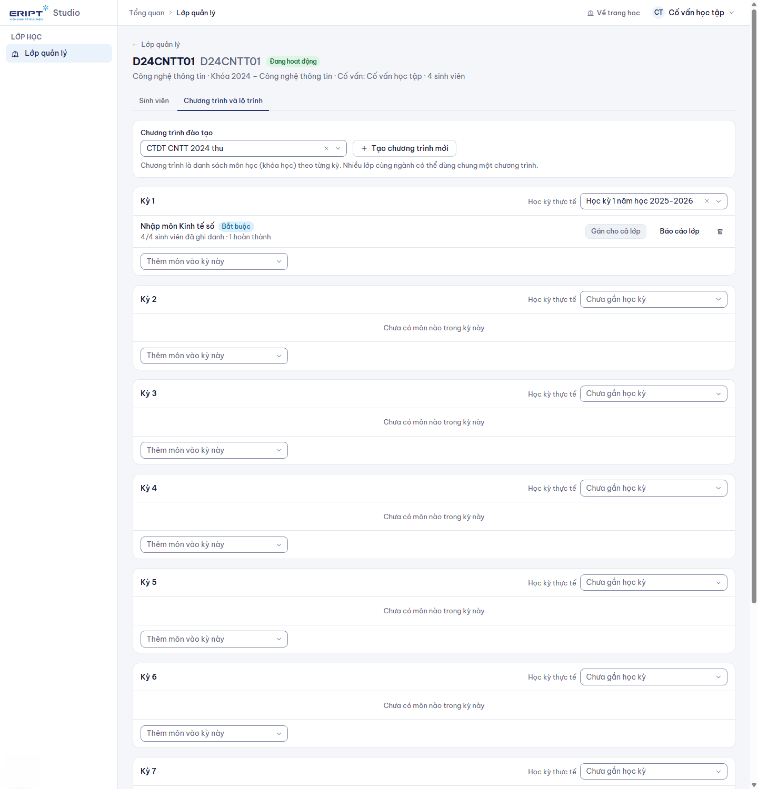
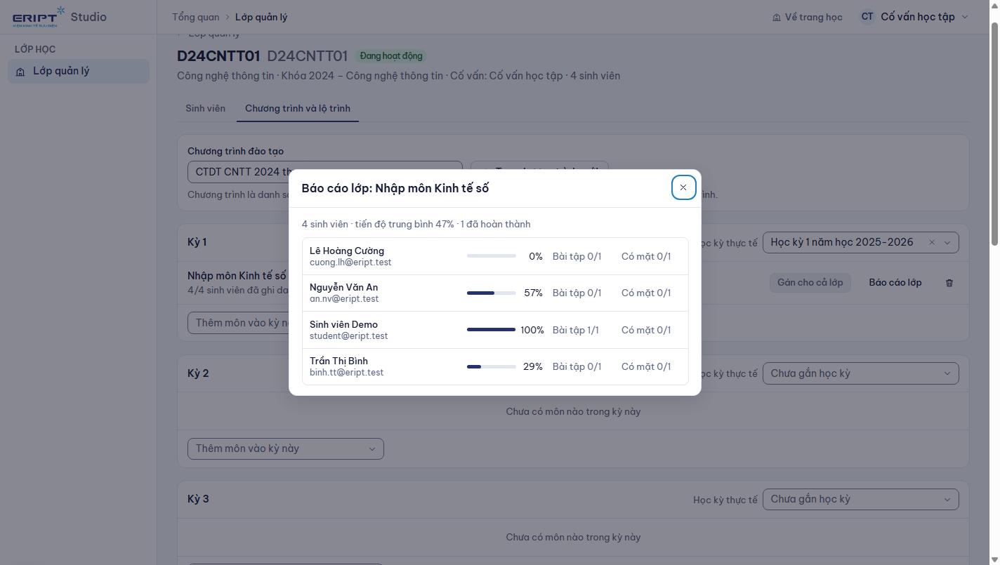

# Hướng dẫn dành cho cố vấn học tập

Cố vấn học tập phụ trách một hay nhiều **lớp hành chính** do quản trị viên hoặc giáo vụ phân công. Việc của bạn: giữ danh sách sinh viên của lớp, xây **chương trình đào tạo** (môn nào học ở kỳ nào, kỳ đó là học kỳ thật nào) và **gán môn cho cả lớp**, rồi theo dõi tiến độ.

Đăng nhập: xem [00-dang-nhap-va-tai-khoan.md](00-dang-nhap-va-tai-khoan.md). Sau khi đăng nhập bạn vào thẳng **Lớp quản lý**; thanh menu chỉ có mục này.

## 1. Danh sách lớp của bạn

- Mỗi dòng: mã và tên lớp, chương trình (ngành), khóa, cố vấn, chương trình đào tạo đang dùng và số sinh viên.
- Tìm theo mã hoặc tên lớp. Ba bộ lọc **Khóa**, **Chương trình**, **Năm nhập học** cho chọn **nhiều giá trị**: mở danh sách, gõ để tìm, tick các ô cần lọc.
- Bấm một lớp để vào chi tiết. Bạn chỉ thấy lớp mình phụ trách; không thấy lớp của cố vấn khác.

Chưa thấy lớp nào: nhờ quản trị viên hoặc giáo vụ gán bạn làm cố vấn ở **Học vụ > Lớp hành chính** (xem [04-giao-vu.md](04-giao-vu.md)).

## 2. Quản lý sinh viên của lớp

Chi tiết lớp, tab **Sinh viên**.

- Bảng cho biết từng sinh viên: số khóa học đã ghi danh và tiến độ trung bình.
- **Thêm sinh viên**: dán email hoặc mã sinh viên, mỗi dòng một giá trị (tối đa 500), bấm **Thêm sinh viên**. Kết quả cho biết số đã thêm, đã có trong lớp, không tìm thấy và những người được chuyển từ lớp khác sang.
- Sinh viên đang ở lớp khác sẽ được **chuyển** sang lớp này.
- **Đưa ra khỏi lớp** (biểu tượng thùng rác): sinh viên không còn thuộc lớp; các khóa học đã ghi danh vẫn giữ.
- Tài khoản sinh viên chưa có thì nhờ quản trị viên tạo hoặc nhập từ Excel ở **Quản trị > Người dùng**.

## 3. Chương trình đào tạo và lộ trình của lớp

Chi tiết lớp, tab **Chương trình và lộ trình**.

### 3.1 Chọn hoặc tạo chương trình

- Ô **Chương trình đào tạo**: chọn một chương trình có sẵn của ngành (có ô tìm kiếm).
- Chưa có thì bấm **Tạo chương trình mới**, nhập tên; chương trình mới gắn ngay vào lớp.
- Nhiều lớp cùng ngành có thể dùng chung một chương trình. Khi đó hệ thống hiện cảnh báo **đang dùng chung cho N lớp**: thêm hoặc bỏ môn ở đây áp dụng cho cả N lớp.

### 3.2 Gắn kỳ với học kỳ thật

Chương trình chia thành **Kỳ 1, Kỳ 2, ...**. Với mỗi kỳ, ô **Học kỳ thực tế** cho chọn học kỳ thật (ví dụ "Học kỳ 1 năm học 2026-2027"). Đây là cách các môn **mở dần theo năm học**: sinh viên ghi danh vào môn của kỳ nào thì gắn với học kỳ và năm học tương ứng, và báo cáo lọc được theo năm học.

Học kỳ phải do giáo vụ tạo trước ở **Học vụ > Học kỳ**.

### 3.3 Thêm môn vào kỳ

Mỗi kỳ có ô **Thêm môn vào kỳ này**: mở, gõ tên để tìm khóa học rồi chọn. Môn hiện trong kỳ kèm số sinh viên đã ghi danh. Bỏ môn khỏi chương trình bằng biểu tượng thùng rác ở dòng môn.

### 3.4 Gán môn cho cả lớp

Ở dòng môn bấm **Gán cho cả lớp** rồi xác nhận. Tất cả sinh viên của lớp được ghi danh vào khóa học đó; sinh viên đã có sẵn được giữ nguyên. Khóa học xuất hiện ngay trong **Việc học của tôi** của sinh viên.

- Chỉ gán được khóa học **đã xuất bản**.
- Thêm sinh viên mới vào lớp sau đó thì bấm **Gán cho cả lớp** lần nữa để ghi danh họ.

### 3.5 Báo cáo lớp theo từng môn

Ở dòng môn bấm **Báo cáo lớp**: danh sách sinh viên của lớp trong môn đó với tiến độ, số bài tập đã nộp, số buổi có mặt. Nhãn **Cần chú ý** là sinh viên chưa hoàn thành mà lâu không hoạt động.

Bạn chỉ xem được báo cáo **của lớp mình** (không xem được lớp khác hay toàn bộ khóa). Muốn báo cáo đầy đủ của khóa, nhờ giảng viên của khóa.

## 4. Bạn không làm được gì

| Việc | Ai làm |
|---|---|
| Tạo lớp, năm học, học kỳ, khóa | Giáo vụ hoặc quản trị viên |
| Tạo tài khoản sinh viên, đổi vai trò | Quản trị viên |
| Sửa nội dung khóa học, ra đề, chấm bài | Giảng viên của khóa |

## 5. Gặp sự cố

| Tình huống | Cách xử lý |
|---|---|
| Không thấy khóa học trong ô Thêm môn | Khóa chưa xuất bản hoặc đã có trong chương trình; nhờ giảng viên gửi duyệt |
| Gán xong sinh viên không thấy khóa | Sinh viên đăng nhập lại; kiểm tra sinh viên đúng là thành viên lớp |
| Báo "Lớp chưa có chương trình đào tạo" khi thêm môn | Chọn hoặc tạo chương trình trước |
| Không mở được báo cáo lớp | Chưa có sinh viên nào của lớp ghi danh môn đó (nút bị mờ) |
