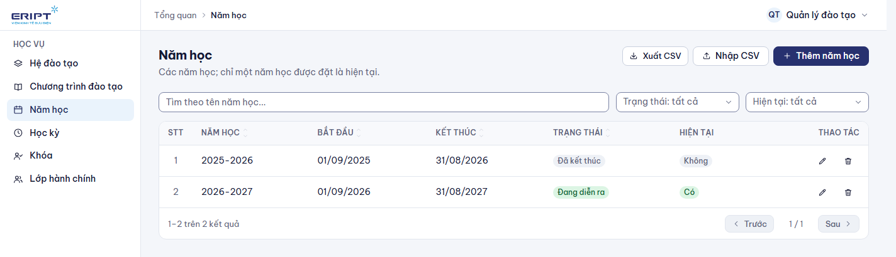
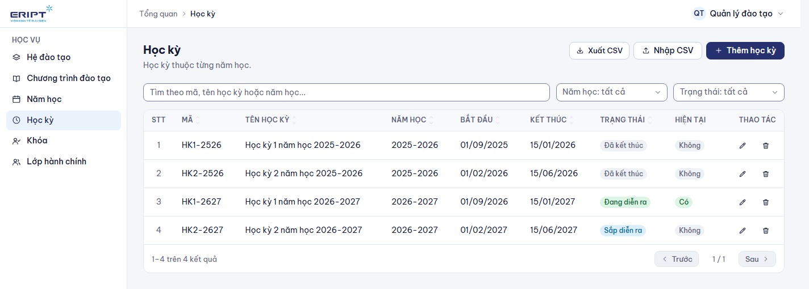
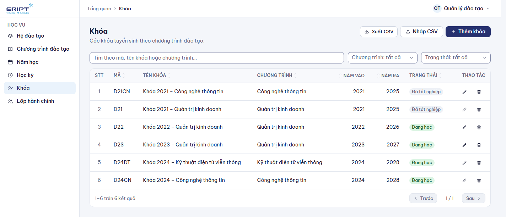
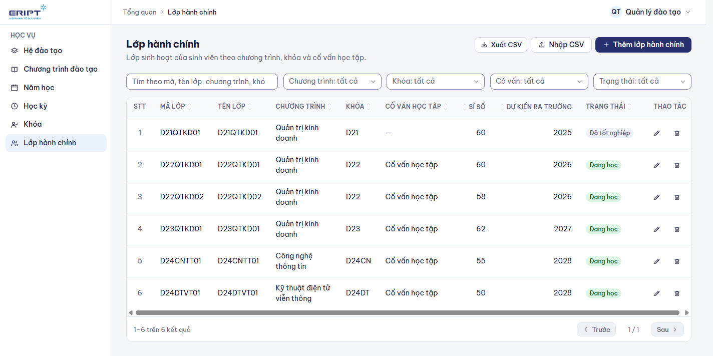
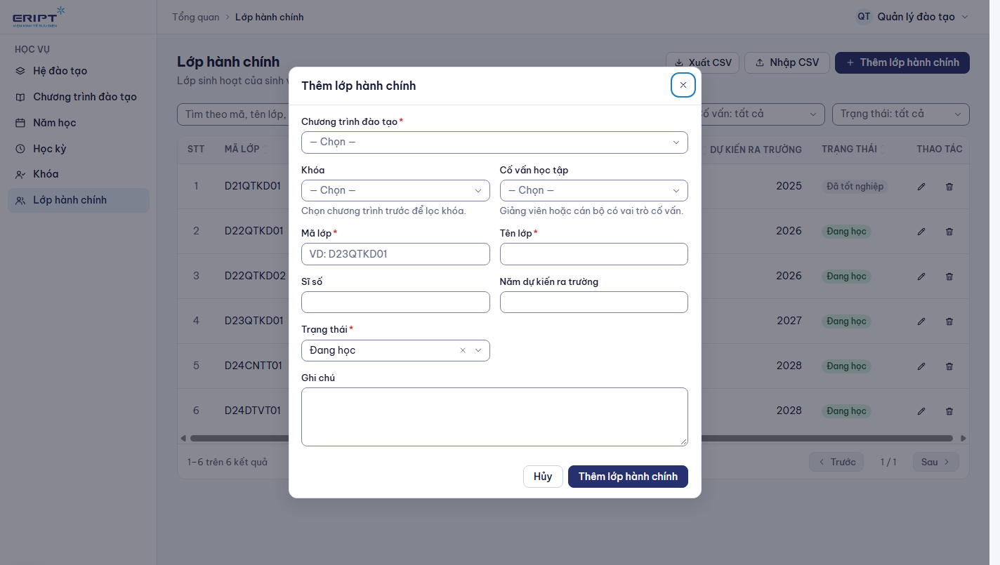
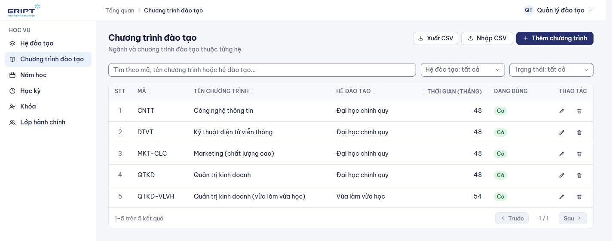

# Hướng dẫn dành cho giáo vụ (quản lý đào tạo)

Giáo vụ dựng **cấu trúc học vụ** để cố vấn, giảng viên và sinh viên làm việc trên đó: hệ đào tạo, chương trình, năm học, học kỳ, khóa và lớp hành chính. Đăng nhập xong bạn vào thẳng **Học vụ > Lớp hành chính**; thanh menu chỉ có nhóm **Học vụ**.

Đăng nhập: xem [00-dang-nhap-va-tai-khoan.md](00-dang-nhap-va-tai-khoan.md).

## 1. Thứ tự dựng một năm học mới

Cái sau cần cái trước nên làm theo đúng thứ tự:

| Bước | Màn hình | Việc làm |
|---|---|---|
| 1 | **Hệ đào tạo** và **Chương trình đào tạo** | Thường có sẵn (chính quy, CNTT, Quản trị kinh doanh...). Chỉ thêm khi mở ngành mới |
| 2 | **Năm học** | Tạo năm học mới, ví dụ `2027-2028` |
| 3 | **Học kỳ** | Tạo các học kỳ thuộc năm học đó |
| 4 | **Khóa** | Tạo khóa (niên khóa) cho đợt tuyển sinh mới, thuộc một chương trình |
| 5 | **Lớp hành chính** | Tạo các lớp thuộc khóa, gán cố vấn học tập |

Sau đó cố vấn học tập thêm sinh viên vào lớp, chọn chương trình đào tạo và gán môn (xem [03-co-van-hoc-tap.md](03-co-van-hoc-tap.md)).

## 2. Cách thao tác chung

Mọi màn trong nhóm Học vụ có cùng bố cục:

- Thanh tìm kiếm và các bộ lọc ở trên (bộ lọc dài có ô tìm kiếm).
- Bảng dữ liệu: bấm tiêu đề cột để sắp xếp; bút để sửa, thùng rác để xóa.
- Nút **Thêm ...** ở góc phải trên mở biểu mẫu.
- **Xuất CSV** tải toàn bộ danh sách; **Nhập CSV** thêm hoặc cập nhật hàng loạt từ tệp (hộp thoại nhập có hướng dẫn cột và tệp mẫu).
- Mã (mã năm học, mã khóa, mã lớp...) không được trùng.

## 3. Năm học

**Thêm năm học**: tên (ví dụ `2027-2028`), ngày bắt đầu, ngày kết thúc (chọn bằng bộ chọn ngày), trạng thái, và tùy chọn **Đặt là năm học hiện tại** (năm học hiện tại cũ sẽ được bỏ đánh dấu; mỗi lúc chỉ một năm hiện tại).

## 4. Học kỳ

**Thêm học kỳ**: chọn **Năm học**, nhập **Mã học kỳ** (ví dụ `HK1-2728`), **Tên học kỳ**, ngày bắt đầu và kết thúc, trạng thái, và tùy chọn đặt là học kỳ hiện tại của năm học. Học kỳ này là thứ cố vấn dùng để gắn với "Kỳ 1, Kỳ 2..." của chương trình.

## 5. Khóa

**Thêm khóa**: chọn **Chương trình đào tạo**, nhập **Mã khóa** (ví dụ `D27`), **Tên khóa**, **Năm vào học**, năm ra trường (tùy chọn), trạng thái.

## 6. Lớp hành chính

Bảng hiển thị mã lớp, tên lớp, chương trình, khóa, cố vấn, sĩ số, dự kiến ra trường và trạng thái. Lọc theo chương trình, khóa, cố vấn, trạng thái.

**Thêm lớp hành chính**:

| Trường | Ghi chú |
|---|---|
| Chương trình đào tạo | Chọn trước; danh sách **Khóa** lọc theo chương trình này |
| Khóa | Khóa của lớp |
| **Cố vấn học tập** | Người có vai trò cố vấn hoặc giảng viên. Người này thấy lớp trong **Lớp quản lý** |
| Mã lớp, Tên lớp | Bắt buộc, mã không trùng (ví dụ `D27CNTT01`) |
| Sĩ số, dự kiến ra trường, trạng thái, mô tả | Thông tin bổ sung |

Đổi cố vấn: sửa lớp rồi chọn cố vấn khác. Lớp đã tốt nghiệp đổi trạng thái để lọc ra khỏi danh sách lớp đang học.

## 7. Chương trình đào tạo

Đây là danh mục **chương trình/ngành** (ví dụ Công nghệ thông tin, Quản trị kinh doanh) gắn với hệ đào tạo, thời gian đào tạo. Không nhầm với "chương trình đào tạo của lớp" (danh sách môn theo kỳ) do cố vấn học tập quản lý trong **Lớp quản lý**.

## 8. Xem lớp như cố vấn

Quyền giáo vụ cũng mở được **Lớp quản lý** ở Studio (`/studio/classes`) để xem mọi lớp, thêm sinh viên, chỉnh chương trình và gán môn thay cố vấn khi cần.

## 9. Gặp sự cố

| Tình huống | Cách xử lý |
|---|---|
| "Mã đã tồn tại" | Đổi mã khác hoặc sửa bản ghi cũ |
| Không chọn được Khóa khi tạo lớp | Chọn **Chương trình đào tạo** trước |
| Không có cố vấn trong danh sách | Cố vấn phải có vai trò cố vấn hoặc giảng viên: nhờ quản trị viên cấp ở **Người dùng** |
| Không xóa được năm học, học kỳ, khóa | Đang có dữ liệu liên quan (lớp, ghi danh); chuyển trạng thái thay vì xóa |
