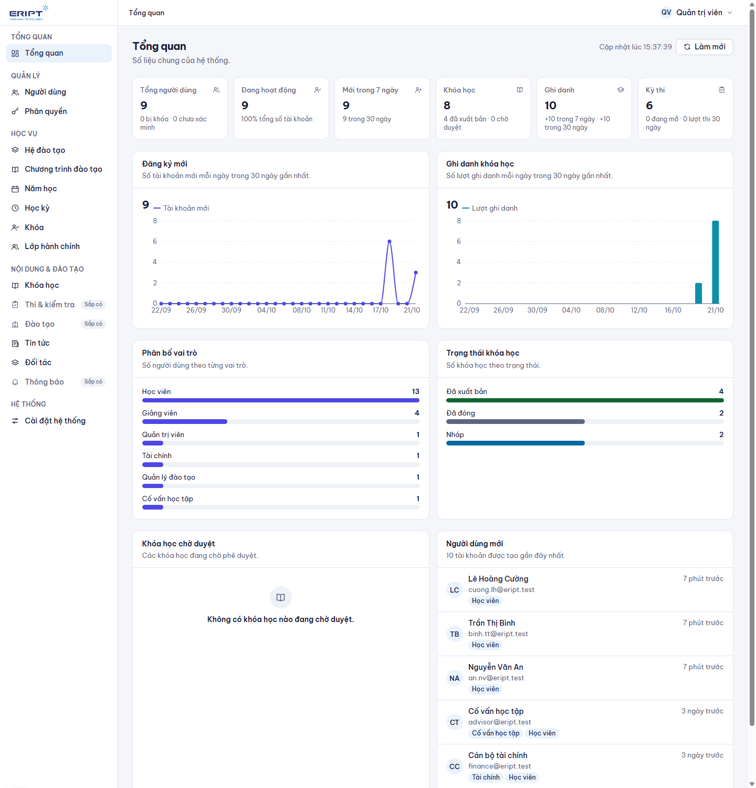
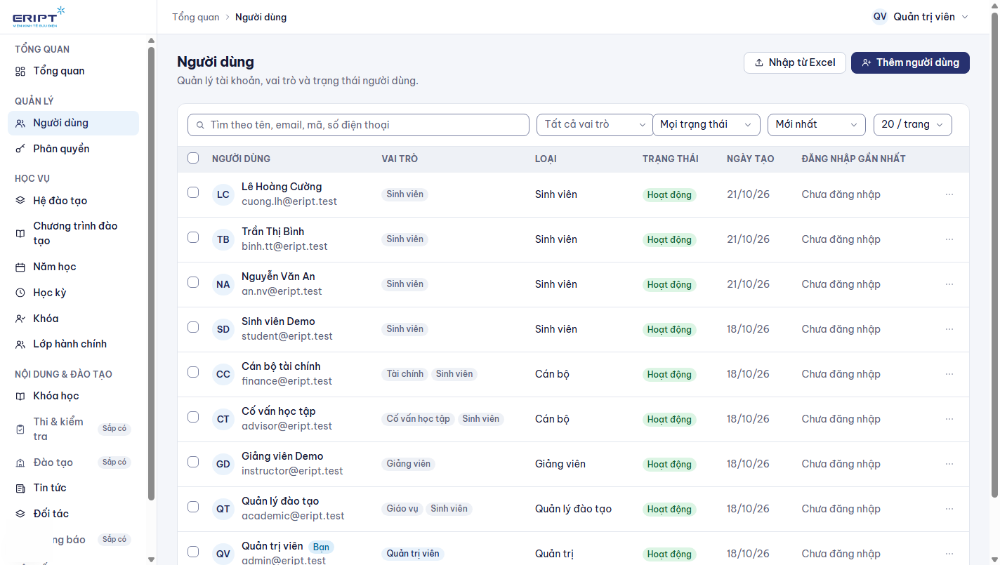
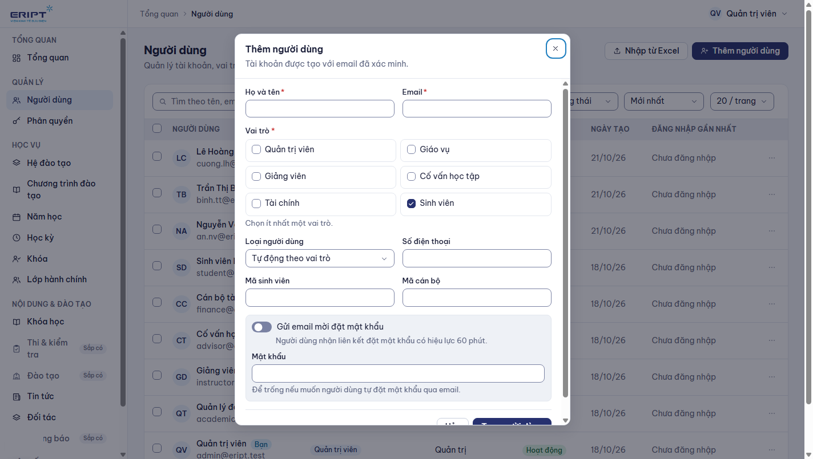
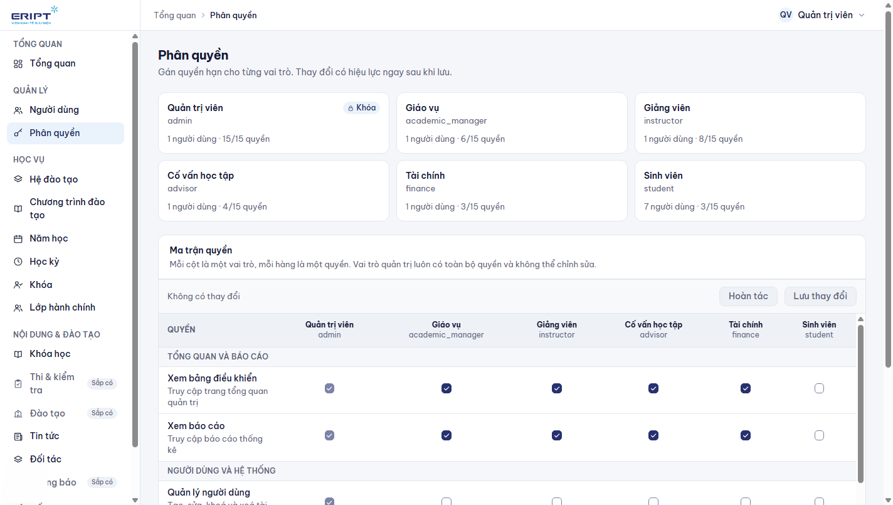
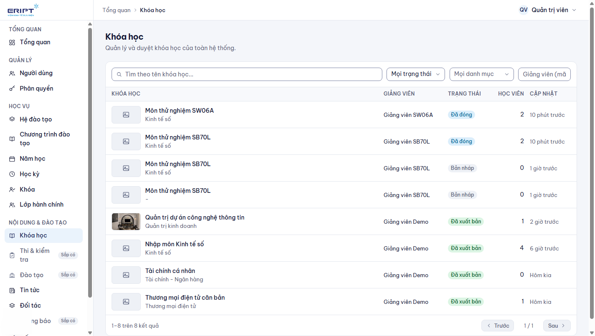
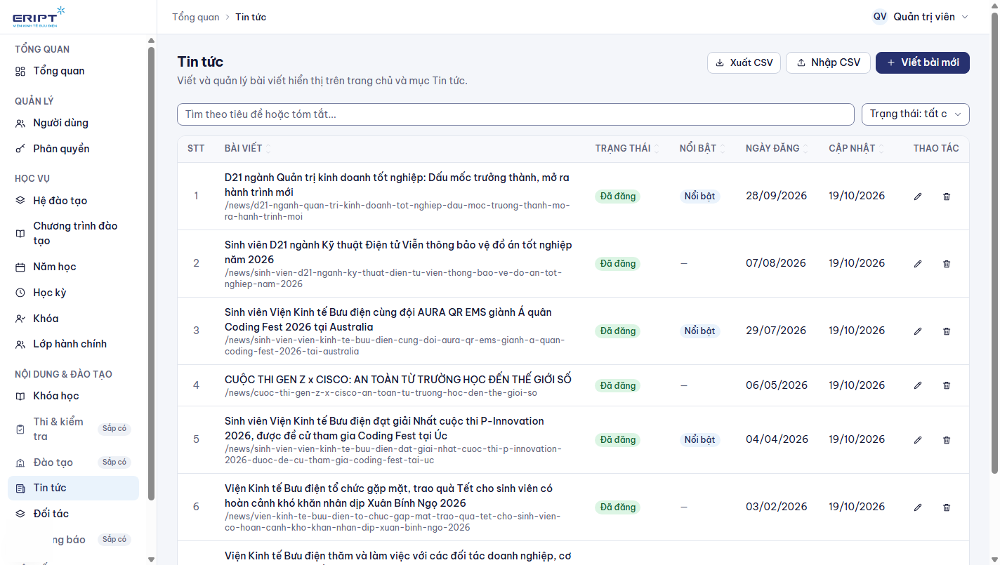
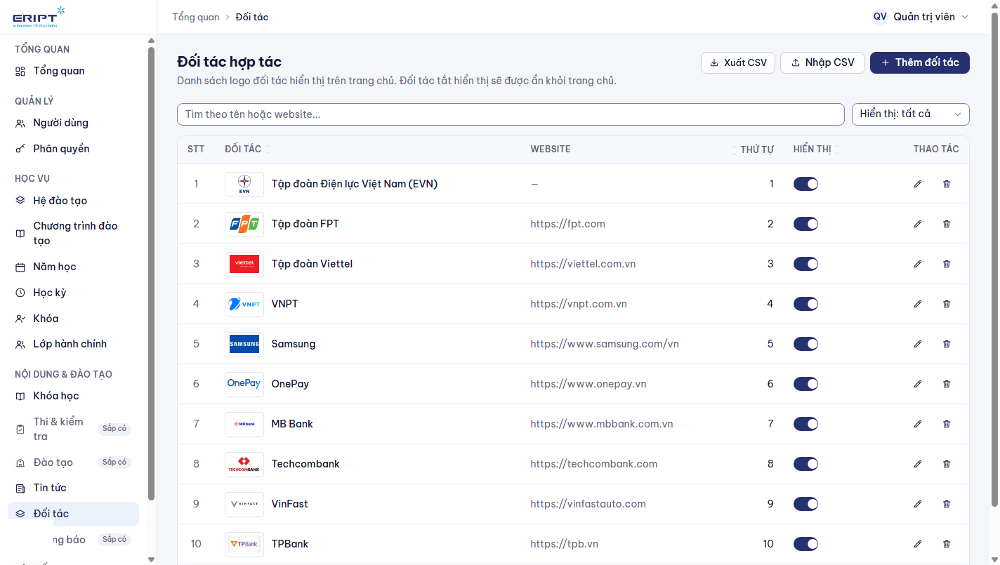
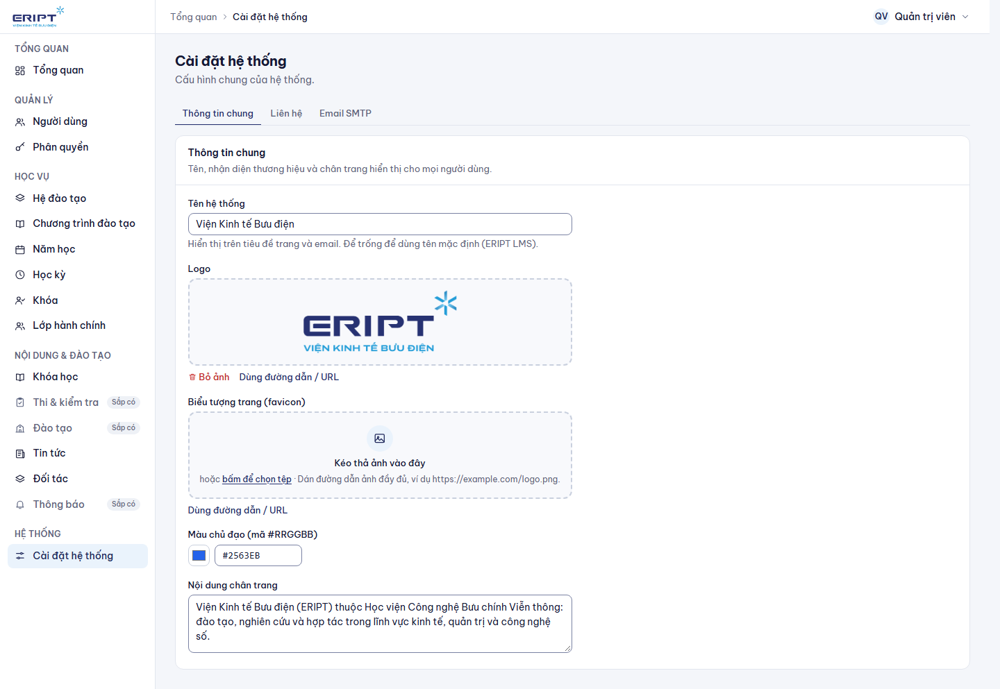

# Hướng dẫn dành cho quản trị viên

Quản trị viên có toàn quyền: người dùng, phân quyền, học vụ, duyệt khóa học, nội dung trang chủ và cài đặt hệ thống. Đăng nhập: xem [00-dang-nhap-va-tai-khoan.md](00-dang-nhap-va-tai-khoan.md); bạn vào trang **Tổng quan** quản trị.

Quản trị viên cũng dùng được Studio (`/studio`) như giảng viên và xem được mọi khóa học.

## 1. Tổng quan

Các thẻ số liệu: tổng người dùng, đang hoạt động, mới trong 7 ngày, khóa học (đã xuất bản, chờ duyệt), ghi danh, kỳ thi. Biểu đồ đăng ký mới và ghi danh 30 ngày; phân bố vai trò; trạng thái khóa học; danh sách **Khóa học chờ duyệt** và **Người dùng mới**. Bấm **Làm mới** để cập nhật.

## 2. Người dùng

**Quản lý > Người dùng**.

### Tìm và lọc

Tìm theo tên, email, mã, số điện thoại; lọc theo vai trò (ô có tìm kiếm), trạng thái, sắp xếp, số dòng mỗi trang.

### Tạo người dùng

Bấm **Thêm người dùng**.

1. Nhập **Họ và tên** và **Email**.
2. Tick các **vai trò** (Quản trị viên, Giáo vụ, Giảng viên, Cố vấn học tập, Tài chính, Sinh viên). Một người có thể có nhiều vai trò; mặc định là Sinh viên. Muốn giảng viên thì bỏ tick Sinh viên và tick Giảng viên.
3. Chọn **Loại người dùng** (để tự động theo vai trò), số điện thoại, **Mã sinh viên** hoặc **Mã cán bộ** nếu có.
4. Đặt **Mật khẩu**, hoặc bật gửi thư mời để người dùng tự đặt mật khẩu qua email.
5. Bấm **Tạo người dùng**.

### Nhập sinh viên từ Excel

**Nhập từ Excel**: tải tệp mẫu, điền danh sách sinh viên, tải lên. Hệ thống báo số tài khoản tạo mới, đã có và lỗi từng dòng.

### Thao tác trên từng người

Biểu tượng **...** cuối dòng: **Xem và chỉnh sửa** (hồ sơ, mã, ngày sinh...), **Đổi vai trò**, **Khóa tài khoản** / **Mở khóa tài khoản** (người bị khóa không đăng nhập được), **Gửi email đặt lại mật khẩu** (hệ thống không hiển thị mật khẩu tạm; người dùng nhận đường dẫn qua email), **Xóa người dùng** (xóa mềm, giữ lịch sử học tập).

Tick nhiều dòng để **Khóa**, **Mở khóa** hoặc **Xóa** hàng loạt.

## 3. Phân quyền

**Quản lý > Phân quyền**: xem và chỉnh các quyền của từng vai trò (ví dụ giảng viên có quyền quản lý khóa học, bài học, kỳ thi, điểm). Mỗi cột là một vai trò, mỗi hàng là một quyền; lưu xong có hiệu lực ngay. Quản trị viên luôn có mọi quyền.

Bảng quyền mặc định xem ở [../RBAC.md](../RBAC.md).

## 4. Học vụ

Nhóm **Học vụ** giống hệt giao diện giáo vụ: Hệ đào tạo, Chương trình đào tạo, Năm học, Học kỳ, Khóa, Lớp hành chính. Xem [04-giao-vu.md](04-giao-vu.md) để biết thứ tự dựng một năm học mới và cách gán cố vấn.

## 5. Duyệt khóa học

**Nội dung và đào tạo > Khóa học**.

1. Lọc theo trạng thái (**Chờ duyệt**) hoặc danh mục.
2. Bấm một khóa để mở ngăn chi tiết: mô tả, giảng viên, nội dung.
3. Bấm **Duyệt & xuất bản** để công khai khóa học, hoặc **Từ chối** và nhập lý do (giảng viên thấy lý do này và có thể sửa rồi gửi lại).
4. **Mở trong Studio** để xem hoặc sửa nội dung khóa.

Quản trị viên cũng có thể **Xuất bản ngay** không cần duyệt ở tab Xuất bản của khóa.

## 6. Nội dung trang chủ: tin tức và đối tác

### Tin tức

**Nội dung và đào tạo > Tin tức**.

- **Viết bài mới**: tiêu đề, tóm tắt, nội dung, **ảnh bìa**, trạng thái (nháp hoặc đã đăng), bật **Bài nổi bật**.
- Nhập và xuất hàng loạt qua CSV.
- **Trang chủ lấy tin từ đây**: slider ở đầu trang chủ gồm một slide giới thiệu và tối đa 4 tin mới nhất **có ảnh bìa**; khối **Tin tức và hoạt động** có 1 tin lớn và 4 tin kế tiếp. Muốn tin lên slider, đăng bài và gắn ảnh bìa (ảnh ngang, tỉ lệ khoảng 16:9 cho đẹp).

### Đối tác

**Nội dung và đào tạo > Đối tác**.

Thêm logo và tên đối tác, đường dẫn website (tùy chọn), bật hoặc tắt **Hiển thị trên trang chủ**. Logo chạy thành dải cuộn chậm ở cuối trang chủ.

### Số liệu trên trang chủ

Thanh số liệu (khóa học, giảng viên, bài học, người học) tự tính từ các khóa học **đã xuất bản**; không cần nhập tay.

## 7. Cài đặt hệ thống

**Hệ thống > Cài đặt hệ thống** có 3 tab.

| Tab | Nội dung |
|---|---|
| **Thông tin chung** | Tên hệ thống (hiện trên tiêu đề trang và email), logo, biểu tượng trang, màu chủ đạo, nội dung chân trang |
| **Liên hệ** | Email, số điện thoại, địa chỉ hiển thị ở chân trang |
| **Email SMTP** | Máy chủ gửi email (xác thực tài khoản, quên mật khẩu, thư mời). Nhập máy chủ, cổng, tài khoản, mật khẩu, kiểu mã hóa |

Thay đổi chưa lưu có cảnh báo khi rời trang; bấm lưu ở cuối mỗi tab.

## 8. Việc quản trị viên nên kiểm tra định kỳ

| Việc | Ở đâu |
|---|---|
| Khóa học chờ duyệt | Tổng quan, hoặc **Khóa học** lọc Chờ duyệt |
| Tài khoản mới và tài khoản bị khóa | **Người dùng** |
| Gửi email còn hoạt động | Thử **Quên mật khẩu** với một tài khoản; kiểm tra tab **Email SMTP** |
| Cố vấn đã được gán cho các lớp mới | **Học vụ > Lớp hành chính** |

## 9. Gặp sự cố

| Tình huống | Cách xử lý |
|---|---|
| Người dùng không nhận email | Kiểm tra tab Email SMTP; xem thư rác; thử gửi lại |
| Người dùng không thấy menu Studio | Thiếu vai trò Giảng viên; mở **Đổi vai trò** |
| Cố vấn không thấy lớp | Lớp chưa gán cố vấn; sửa ở **Lớp hành chính** |
| Khóa học không lên trang chủ | Chưa xuất bản; trang chủ chỉ hiện khóa đã xuất bản |
| Slider chỉ có một slide | Chưa có tin nào có ảnh bìa |
